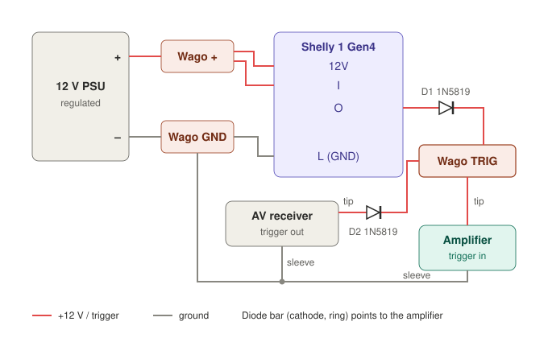
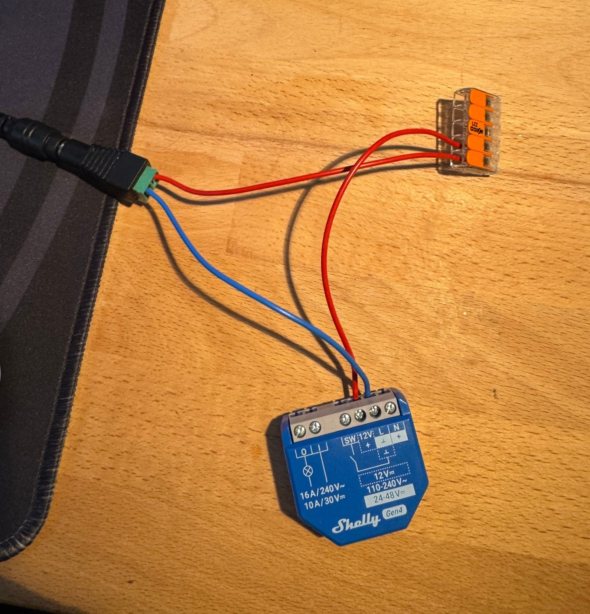
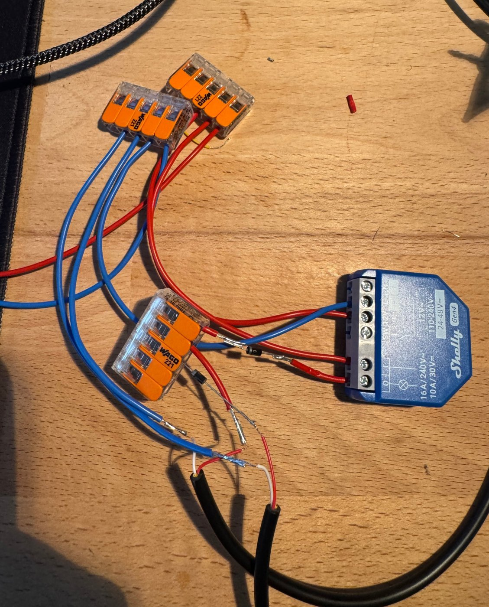
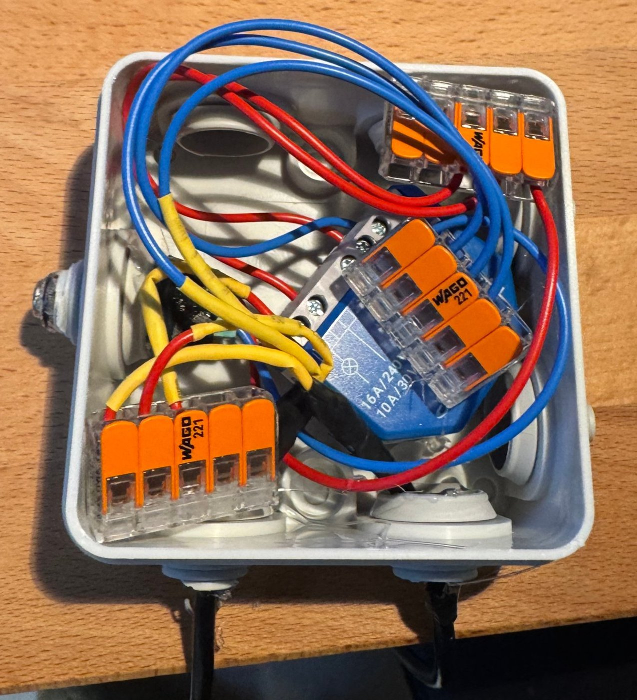

# Shelly 12-V-Trigger – HiFi-Endstufe aus zwei Quellen schalten (ODER-Schaltung)

**Deutsch** | [English](README.md)

Eine kleine Zusatzschaltung, mit der sich eine Endstufe mit **12-V-Trigger-Eingang** von **zwei unabhängigen Quellen** einschalten lässt:

- vom vorhandenen 12-V-Trigger-Ausgang eines AV-Receivers **oder**
- von einem **Shelly 1 Gen4**, gesteuert über Home Assistant (oder ein anderes System).

Zwei Schottky-Dioden führen beide Quellen zusammen („Dioden-ODER“). Jede Quelle schaltet die Endstufe ein. Aus geht sie erst, wenn beide Quellen aus sind. Keine Quelle kann Spannung in die andere zurückspeisen.

Typischer Anwendungsfall: Die Endstufe wird normalerweise vom AV-Receiver geweckt. Für reines Stereo (Streamer → Vorverstärker → Endstufe, Receiver aus) soll sie aber per Hausautomation angehen.

> **Sicherheit:** Die Schaltung arbeitet ausschließlich mit 12 V DC aus einem fertigen Steckernetzteil. Der Shelly wird nur über dieses Netzteil versorgt. Keine Netzspannung an irgendeinen Teil der Schaltung anschließen. Nachbau auf eigene Verantwortung.



## Getestet mit

| Rolle | Gerät |
|---|---|
| Endstufe | Hypex Nilai500 DIY Stereo Kit (Trigger-Eingang 3,5 mm TS, 6–18 V DC) |
| AV-Receiver | Denon AVR-X4700H (12-V-Trigger-Ausgang) |
| Streamer | Cambridge Audio MXN10 (Roon Ready) |
| Vorverstärker | Topping Pre90 (Eingangswahl per IR über einen Broadlink-Sender) |
| Relais | Shelly 1 Gen4, Versorgung 12 V DC, WLAN |
| Netzteil | Mean Well GST18E12-P1J (12 V / 1,5 A, stabilisiert, Schutzklasse II) |
| Steuerung | Home Assistant mit Roon-Integration |

Das Prinzip funktioniert mit jeder Endstufe, deren Trigger-Eingang die anliegende Spannung verträgt (etwa 11,7–12,2 V hinter der Diode), und mit jeder Trigger-Quelle mit 12-V-Ausgang. Prüf den Trigger-Spannungsbereich deiner eigenen Geräte.

## Material

| Anzahl | Teil | Zweck |
|---|---|---|
| 1 | Shelly 1 Gen4 | potentialfreies Relais, schaltet 12 V auf die Trigger-Leitung |
| 2 | Schottky-Diode 1N5819 (1 A, 40 V) | Dioden-ODER, eine pro Quelle |
| 1 | stabilisiertes 12-V-Netzteil, z. B. Mean Well GST18E12-P1J | versorgt den Shelly und liefert die Trigger-Spannung |
| 1 | Hohlbuchsen-Adapter 5,5/2,1 mm mit Schraubklemmen | Netzteil-Anschluss, ohne das Kabel abzuschneiden |
| 2 | 3,5-mm-Mono-Klinkenkabel (TS) | halbiert: eins zum Trigger-Ausgang des Receivers, eins zum Trigger-Eingang der Endstufe |
| 3 | Wago-221-Hebelklemmen (eine mit mindestens 4 Plätzen) | Knoten +12 V, Masse, Trigger |
| – | Litze, Lötkolben, Lötzinn | dünne Klinkenadern und Diodenbeine auf Litze löten, damit sie sicher in den Klemmen halten |
| 1 | kleine Abzweigdose | Gehäuse |
| – | Schrumpfschlauch, Multimeter | Isolierung, Messungen |

Das Netzteil muss stabilisiert sein, denn der 12-V-Eingang des Shelly braucht stabilisierte 12 V DC. Moderne Schaltnetzteile sind das praktisch immer. Ungeeignet sind alte, schwere Trafo-Steckernetzteile ohne Regelung: Sie liefern bei geringer Last deutlich mehr als 12 V.

## Funktionsprinzip

Jede Quelle bekommt ihre eigene Diode zwischen sich und dem gemeinsamen Trigger-Knoten. Die Kathode (der Ring auf der Diode) zeigt zur Endstufe. Jede Diode wirkt wie ein Rückschlagventil:

- **Shelly an, Receiver aus:** Der Strom fließt über D1 zur Endstufe. D2 sperrt, am Trigger-Ausgang des Receivers kommt nichts an.
- **Receiver an, Shelly aus:** Der Strom fließt über D2 zur Endstufe. D1 sperrt, am Shelly-Ausgang kommt nichts an.
- **Beide aus:** Am Trigger-Eingang liegen 0 V, die Endstufe geht in Standby.

Eine einzelne Diode vor der Endstufe funktioniert **nicht**: Dann wären die beiden Quellen direkt verbunden, und die 12 V des Shelly würden in den Trigger-Ausgang des Receivers gedrückt.

Alle Massen (Netzteil-Minus, Shelly-Masse, beide Kabel-Schäfte) müssen verbunden sein. Ein Netzteil der Schutzklasse II (ohne Schutzleiter) vermeidet Brummschleifen.

## Verkabelung

Die drei Knoten heißen wie im Schaltplan:

| Knoten | Angeschlossen |
|---|---|
| Wago + | Netzteil +, Shelly `12V`, Shelly `I` |
| Wago GND (Masse) | Netzteil –, Shelly `L` (⏚), Schaft Endstufen-Kabel, Schaft Receiver-Kabel |
| Wago TRIG (Trigger) | Kathode (Ring) D1, Kathode (Ring) D2, Spitze Endstufen-Kabel |

- D1: Shelly `O` → Anode D1 (ohne Ring) → Kathode (Ring) → Wago TRIG
- D2: Spitze Receiver-Kabel → Anode D2 (ohne Ring) → Kathode (Ring) → Wago TRIG
- Shelly `SW` und `N` bleiben frei.

### Klemmen des Shelly 1 Gen4 bei 12 V DC

Lies den Aufdruck auf dem Gerät. Beim Shelly 1 Gen4 gilt bei DC-Versorgung:

| Klemme | Bedeutung bei DC |
|---|---|
| `12V` | **+12 V** (stabilisiertes 12-V-Netzteil) |
| `L` | **⏚ Masse** für 12 V und 24–48 V |
| `N` | **+** nur für 24–48 V, bei 12 V **nicht** belegen |

`I` und `O` sind ein potentialfreier Relaiskontakt (max. 30 V DC). `I` bekommt +12 V, `O` ist der geschaltete Ausgang.



## Aufbau

Alles bei ausgestecktem Netzteil verkabeln.

1. **Adern zuordnen:** Beide TS-Kabel halbieren. Mit dem Durchgangsprüfer bestimmen, welche Ader zur Spitze und welche zum Schaft gehört. Die Spitzen-Ader markieren.
2. **Adern vorbereiten:** Die dünnen Klinkenadern und die Diodenbeine auf Litze löten und mit Schrumpfschlauch isolieren. So halten sie sicher in den Wago-Klemmen.
3. **Polung am Netzteil prüfen** (am Hohlbuchsen-Adapter): etwa +12 V zwischen `+` und `–`.
4. **Dioden prüfen** im Diodentest: etwa 0,2–0,35 V in Durchlassrichtung (gemessen: 185 mV), „OL“ in Sperrrichtung.
5. **Shelly versorgen:** Netzteil + über Wago + an `12V`, Netzteil – über Wago GND an `L`. Brücke von `12V` nach `I`.
6. **Zuerst die Shelly-Seite:** `O` → D1 → Wago TRIG → Spitze Endstufe. Schaft Endstufe → Wago GND.
7. **Messen** an Wago TRIG gegen Masse: Shelly aus ≈ 0 V, Shelly an ≈ 12 V (gemessen: 12,19 V).
8. **Test mit der Endstufe:** Endstufen-Kabel einstecken. Shelly an → Endstufe an. Shelly aus → Endstufe aus.
9. **Receiver ergänzen:** Spitze Receiver → D2 → Wago TRIG, Schaft Receiver → Wago GND.
10. **Rückspeisung prüfen:** Shelly an, Receiver aus. Spitze des Receiver-Kabels (vor D2) gegen Masse messen: muss ≈ 0 V sein (gemessen: 0,6 mV).
11. Alle freiliegenden Stellen isolieren und alles in die Abzweigdose packen.





## Testergebnisse

| Situation | Ergebnis |
|---|---|
| Shelly an | Endstufe an |
| Shelly aus (Receiver aus) | Endstufe sofort aus |
| Receiver an, Shelly aus | Endstufe an |
| Shelly an, Receiver ein- und ausgeschaltet | Endstufe bleibt an |
| Beide aus | Endstufe aus |
| Shelly an, Receiver aus: Spannung an der Receiver-Spitze | 0,6 mV (D2 sperrt) |

Ein Pull-down-Widerstand war nicht nötig: Sperren beide Dioden, hängt der Trigger-Eingang offen, und die Endstufe ging trotzdem sofort aus. Prüf das bei deiner Endstufe (Test: 12 V anlegen, dann die Plusleitung abklemmen, ohne sie auf Masse zu legen). Bleibt sie an, einen 10-kΩ-Widerstand zwischen Spitze und Schaft auf der Endstufen-Seite setzen.

## Shelly-Einstellungen

- Web-UI → Output 0 → **Action on Power On: Turn OFF**. Nach einem Stromausfall darf der Trigger nicht von selbst angehen.
- Der Eingang `SW` wird nicht genutzt, der Input-Typ spielt keine Rolle.
- Einbindung: WLAN über die Shelly-Integration von Home Assistant. Wird das Netzteil zusammen mit der HiFi-Anlage abgeschaltet (z. B. über eine smarte Steckdose), ist WLAN besser als Zigbee: Ein netzversorgtes Zigbee-Gerät arbeitet als Router, und fällt es jede Nacht aus, stört das das Mesh.

## Gut zu wissen

- **Taster vs. Trigger (Hypex Nilai Kit):** Wurde die Endstufe mit dem Taster an der Front eingeschaltet, schaltet das Wegnehmen der Trigger-Spannung sie **nicht** aus. Die Endstufe nur über den Trigger schalten.
- Die Endstufe meldet ihren Zustand nicht an die Hausautomation. Der Shelly-Zustand zeigt nur, ob die Shelly-Seite des Triggers aktiv ist, nicht ob die Endstufe läuft.
- Nach Stromwiederkehr braucht der Shelly ein paar Sekunden zum Booten und Verbinden (gemessen: ca. 6,4 s). Automationen sollten warten, bis die Schalter-Entity verfügbar ist, bevor sie ihn einschalten.

## Home Assistant

Der Shelly folgt dem Streamer: Er geht an, sobald die Wiedergabe startet, und aus, wenn der Streamer 15 Minuten nicht spielt. Der AV-Receiver steuert die Endstufe weiter über seinen eigenen Trigger, unabhängig von Home Assistant.

| Ereignis | Aktion |
|---|---|
| Roon-Zone des Streamers startet die Wiedergabe | warten, bis der Shelly verfügbar ist (max. 30 s), dann Shelly an |
| Roon-Zone spielt 15 min nicht | Shelly aus (falls an) |
| Receiver an | nichts zu tun: sein Trigger hält die Endstufe über D2 an |

**Warum der Streamer der Auslöser ist und nicht ein Szenen-Knopf:** Musik läuft hier über Roon. Der Roon-Server spielt auf den Streamer, gesteuert wird er von beliebigen Geräten aus (iPhone, iPad, Mac). Einen festen Startknopf gibt es also nicht. Die Roon-Integration von Home Assistant stellt jede Roon-Zone als `media_player` bereit, und deren Zustand `playing` ist das einzige Signal, das unabhängig vom bedienenden Gerät immer kommt. Mit anderen Streaming-Lösungen funktioniert das genauso, solange der Streamer als `media_player` in Home Assistant auftaucht.

Beispiel-Automation. Die beiden Entity-IDs durch die eigenen ersetzen (`media_player.streamer` = Roon-Zone bzw. Streamer, `switch.amp_trigger` = Shelly).

```yaml
alias: "Endstufen-Trigger folgt Streamer"
mode: restart
triggers:
  # Braucht eine aktuelle Home-Assistant-Version. Bei älteren Versionen
  # stattdessen: trigger: state, entity_id: media_player.streamer, to: playing
  - id: "an"
    trigger: media_player.started_playing
    target:
      entity_id: media_player.streamer
  - id: "aus"
    trigger: state
    entity_id: media_player.streamer
    not_to: [playing, unavailable, unknown]
    for:
      minutes: 15
actions:
  - choose:
      - conditions:
          - condition: trigger
            id: "an"
        sequence:
          - wait_template: "{{ not is_state('switch.amp_trigger', 'unavailable') }}"
            timeout:
              seconds: 30
            continue_on_timeout: true
          - action: switch.turn_on
            target:
              entity_id: switch.amp_trigger
            continue_on_error: true
      - conditions:
          - condition: trigger
            id: "aus"
          - condition: state
            entity_id: switch.amp_trigger
            state: "on"
        sequence:
          - action: switch.turn_off
            target:
              entity_id: switch.amp_trigger
```

Hinweise:

- Der Warteschritt ist nur nötig, wenn das Netzteil des Shelly zusammen mit der HiFi-Anlage geschaltet wird.
- `unavailable` und `unknown` sind vom Aus-Trigger ausgenommen, damit ein Streamer, der kurz aus dem Netz fällt, nicht als „spielt nicht“ zählt.
- **Vorverstärker:** In meinem Aufbau schaltet dieselbe Automation vor dem Shelly noch den Topping Pre90 auf den Streamer-Eingang. Das läuft per IR über einen Broadlink-Sender. Weil der Pre90 seinen Eingang nicht zurückmeldet, merkt sich Home Assistant den zuletzt gesetzten Eingang in einem Helfer (`input_select`) und sendet nur, wenn er abweicht. Das ist gerätespezifisch und deshalb nicht im Beispiel. Bei Fragen dazu gern ein Issue aufmachen.

### Testergebnisse (Home Assistant)

| Situation | Ergebnis |
|---|---|
| Wiedergabe vom Handy gestartet | Shelly ca. 0,1 s nach dem Start an, Ton sofort da |
| Streamer 15 min ohne Wiedergabe | Shelly nach genau 15 min aus, Endstufe aus |
| Danach erneut Wiedergabe | Endstufe wieder an |
| Receiver eingeschaltet, während der Streamer spielt (eine separate Automation pausiert den Streamer), dann 15 min | Shelly aus, Endstufe bleibt an (Receiver-Trigger), Ton ohne Unterbrechung |
| Receiver danach ausgeschaltet | Endstufe aus |

## Lizenz

[CC BY 4.0](https://creativecommons.org/licenses/by/4.0/deed.de) – Weitergabe und Bearbeitung erlaubt, auch kommerziell, mit Namensnennung.
