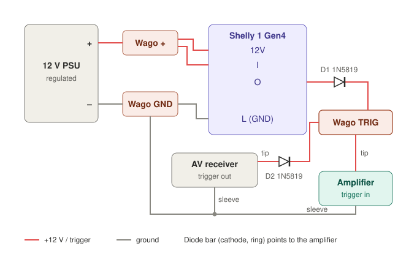

# Shelly 12 V trigger – switch a hi-fi amplifier from two sources (OR circuit)

**English** | [Deutsch](README.de.md)

A small add-on circuit that lets a power amplifier with a **12 V trigger input** be switched on by **two independent sources**:

- the existing 12 V trigger output of an AV receiver, **or**
- a **Shelly 1 Gen4** relay, controlled from Home Assistant (or any other system).

Both sources are combined with two Schottky diodes (a "diode OR"). Either source switches the amplifier on. It only switches off when both sources are off. Neither source can feed voltage back into the other.

Typical use case: the amplifier is normally woken by the AV receiver, but for pure stereo playback (streamer → preamp → power amp, receiver off) it should be switched on by home automation.

> **Safety:** the circuit runs on 12 V DC from an off-the-shelf plug-in power supply only. The Shelly is powered exclusively by that supply. Do not connect mains voltage to any part of this circuit. Build at your own risk.



## Tested with

| Role | Device |
|---|---|
| Amplifier | Hypex Nilai500 DIY Stereo Kit (trigger input 3.5 mm TS, 6–18 V DC) |
| AV receiver | Denon AVR-X4700H (12 V trigger out) |
| Streamer | Cambridge Audio MXN10 (Roon Ready) |
| Preamp | Topping Pre90 (input selection via IR from a Broadlink transmitter) |
| Relay | Shelly 1 Gen4, powered by 12 V DC, Wi-Fi |
| Power supply | Mean Well GST18E12-P1J (12 V / 1.5 A, regulated, class II) |
| Control | Home Assistant with the Roon integration |

The concept works with any amplifier whose trigger input accepts the resulting voltage (about 11.7–12.2 V after the diode) and any trigger source with a 12 V output. Check the trigger voltage range of your own devices.

## Parts

| Qty | Part | Purpose |
|---|---|---|
| 1 | Shelly 1 Gen4 | potential-free relay, switches 12 V onto the trigger line |
| 2 | 1N5819 Schottky diode (1 A, 40 V) | diode OR, one per source |
| 1 | regulated 12 V power supply, e.g. Mean Well GST18E12-P1J | powers the Shelly and provides the trigger voltage |
| 1 | DC barrel jack adapter 5.5/2.1 mm with screw terminals | connects the PSU without cutting its cable |
| 2 | 3.5 mm mono (TS) cables | cut in half: one to the receiver's trigger out, one to the amplifier's trigger in |
| 3 | Wago 221 lever connectors (one needs 4+ slots) | junctions +12 V, ground, trigger |
| – | stranded wire, soldering iron, solder | solder the thin jack-cable cores and the diode legs to stranded wire so they hold securely in the connectors |
| 1 | small junction box | enclosure |
| – | heat-shrink tubing, multimeter | insulation, measurements |

The supply must be regulated, because the Shelly's 12 V input requires stabilised 12 V DC. Modern switch-mode supplies practically always are. Old, heavy transformer wall-warts without regulation are not suitable: at light load they deliver well above 12 V.

## How it works

Each source gets its own diode between itself and the common trigger junction, with the cathode (the ring/bar on the diode) pointing towards the amplifier. Think of each diode as a check valve:

- **Shelly on, receiver off:** current flows through D1 to the amplifier. D2 blocks, so no voltage reaches the receiver's trigger output.
- **Receiver on, Shelly off:** current flows through D2 to the amplifier. D1 blocks, so nothing reaches the Shelly's output.
- **Both off:** the amplifier's trigger input sees 0 V and the amplifier goes to standby.

Placing a single diode in front of the amplifier instead does **not** work: the two sources would be connected directly, and the Shelly's 12 V would be pushed into the receiver's trigger output.

All grounds (PSU minus, Shelly GND, both cable sleeves) must be connected. A class II power supply (no protective earth) avoids ground loops.

## Wiring

The three junctions are named as in the schematic:

| Junction | Connected |
|---|---|
| Wago + | PSU +, Shelly `12V`, Shelly `I` |
| Wago GND | PSU –, Shelly `L` (⏚), amplifier cable sleeve, receiver cable sleeve |
| Wago TRIG | D1 cathode (ring), D2 cathode (ring), amplifier cable tip |

- D1: Shelly `O` → D1 anode (no ring) → cathode (ring) → Wago TRIG
- D2: receiver cable tip → D2 anode (no ring) → cathode (ring) → Wago TRIG
- Shelly `SW` and `N` stay unused.

### Shelly 1 Gen4 terminals on 12 V DC

Read the label on the device. On the Shelly 1 Gen4 the DC terminals are:

| Terminal | Meaning with DC supply |
|---|---|
| `12V` | **+12 V** (regulated 12 V supply) |
| `L` | **⏚ ground** for 12 V and 24–48 V |
| `N` | **+** for 24–48 V only, do **not** use with 12 V |

`I` and `O` are a potential-free relay contact (max. 30 V DC). `I` gets +12 V, `O` is the switched output.


## Build steps

Do all wiring with the power supply unplugged.

1. **Identify the cable cores.** Cut both TS cables in half. Use the multimeter's continuity mode to find which core belongs to the tip and which to the sleeve. Mark the tip core.
2. **Prepare the leads:** solder the thin jack-cable cores and the diode legs to stranded wire and insulate with heat-shrink, so they hold securely in the Wago connectors.
3. **Check the PSU polarity** at the barrel jack adapter: about +12 V between `+` and `–`.
4. **Check the diodes** in diode mode: about 0.2–0.35 V forward (measured: 185 mV), "OL" in reverse.
5. **Power the Shelly:** PSU + via Wago + to `12V`, PSU – via Wago GND to `L`. Add a bridge from `12V` to `I`.
6. **Shelly side first:** `O` → D1 → Wago TRIG → amplifier tip. Amplifier sleeve → Wago GND.
7. **Measure** at Wago TRIG against ground: Shelly off ≈ 0 V, Shelly on ≈ 12 V (measured: 12.19 V).
8. **Test with the amplifier:** plug in the amplifier cable. Shelly on → amplifier on. Shelly off → amplifier off.
9. **Add the receiver:** receiver tip → D2 → Wago TRIG, receiver sleeve → Wago GND.
10. **Back-feed check:** Shelly on, receiver off. Measure the receiver cable tip (before D2) against ground: it must be ≈ 0 V (measured: 0.6 mV).
11. Insulate all exposed parts and put everything into the junction box.


## Test results

| Situation | Result |
|---|---|
| Shelly on | amplifier on |
| Shelly off (receiver off) | amplifier off immediately |
| Receiver on, Shelly off | amplifier on |
| Shelly on, receiver switched on and off | amplifier stays on |
| Both off | amplifier off |
| Shelly on, receiver off: voltage at receiver tip | 0.6 mV (D2 blocks) |

No pull-down resistor was needed: with both diodes blocking, the amplifier's trigger input is left open and the amplifier still switched off immediately. Check this with your own amplifier (test: apply 12 V, then disconnect the + lead without shorting it to ground). If it stays on, add a 10 kΩ resistor between tip and sleeve on the amplifier side.

## Shelly settings

- Web UI → Output 0 → **Action on Power On: Turn OFF**. After a power cut the trigger must not switch on by itself.
- The `SW` input is unused, so the input type does not matter.
- Integration: Wi-Fi via the Home Assistant Shelly integration. If the power supply is switched off together with the hi-fi gear (e.g. by a smart plug), Wi-Fi is preferable to Zigbee: a mains-powered Zigbee device acts as a router, and dropping out every night disturbs the mesh.

## Things to know

- **Front button vs. trigger (Hypex Nilai kit):** if the amplifier was switched on with its front button, removing the trigger voltage does **not** switch it off. Only switch the amplifier via the trigger.
- The amplifier gives no feedback to home automation. The Shelly state shows whether the Shelly side of the trigger is active, not whether the amplifier is on.
- After power returns the Shelly needs a few seconds to boot and reconnect (measured: about 6.4 s). Automations should wait until the switch entity is available before turning it on.

## Home Assistant

The Shelly follows the streamer: it switches on when playback starts and off after the streamer has been idle for 15 minutes. The AV receiver keeps controlling the amplifier through its own trigger, independently of Home Assistant.

| Event | Action |
|---|---|
| The streamer's Roon zone starts playing | wait until the Shelly is available (max. 30 s), then Shelly on |
| Roon zone not playing for 15 min | Shelly off (if it is on) |
| Receiver on | nothing to do: its trigger keeps the amplifier on via D2 |

**Why the streamer is the trigger and not a scene button:** music here runs through Roon. The Roon server plays to the streamer and is controlled from any device (iPhone, iPad, Mac). There is no single start button. The Home Assistant Roon integration exposes every Roon zone as a `media_player`, and its `playing` state is the one signal that always arrives, whichever device started playback. The same approach works with other streaming setups as long as the streamer appears as a `media_player` in Home Assistant.

Example automation. Replace the two entity IDs with your own (`media_player.streamer` = Roon zone or streamer, `switch.amp_trigger` = Shelly).

```yaml
alias: "Amplifier trigger follows streamer"
mode: restart
triggers:
  # Needs a recent Home Assistant version. On older versions use instead:
  # trigger: state, entity_id: media_player.streamer, to: playing
  - id: "on"
    trigger: media_player.started_playing
    target:
      entity_id: media_player.streamer
  - id: "off"
    trigger: state
    entity_id: media_player.streamer
    not_to: [playing, unavailable, unknown]
    for:
      minutes: 15
actions:
  - choose:
      - conditions:
          - condition: trigger
            id: "on"
        sequence:
          - wait_template: "{{ not is_state('switch.amp_trigger', 'unavailable') }}"
            timeout:
              seconds: 30
            continue_on_timeout: true
          - action: switch.turn_on
            target:
              entity_id: switch.amp_trigger
            continue_on_error: true
      - conditions:
          - condition: trigger
            id: "off"
          - condition: state
            entity_id: switch.amp_trigger
            state: "on"
        sequence:
          - action: switch.turn_off
            target:
              entity_id: switch.amp_trigger
```

Notes:

- The wait step is only needed if the Shelly's power supply is switched together with the hi-fi gear.
- `unavailable` and `unknown` are excluded from the off trigger so that a streamer that drops off the network does not count as "idle".
- **Preamp:** in my setup the same automation first switches the Topping Pre90 to the streamer input. This is done via IR from a Broadlink transmitter. Because the Pre90 does not report its input, Home Assistant remembers the last input it set in a helper (`input_select`) and only sends a command when it differs. That part is device-specific and therefore not in the example. Feel free to open an issue if you have questions about it.

### Test results (Home Assistant)

| Situation | Result |
|---|---|
| Playback started from a phone | Shelly on about 0.1 s after playback start, sound immediately |
| Streamer idle for 15 min | Shelly off after exactly 15 min, amplifier off |
| Playback again afterwards | amplifier on again |
| Receiver switched on while the streamer plays (a separate automation pauses the streamer), then 15 min | Shelly off, amplifier stays on (receiver trigger), sound uninterrupted |
| Receiver switched off afterwards | amplifier off |

## License

[CC BY 4.0](https://creativecommons.org/licenses/by/4.0/) – free to share and adapt, including commercially, with attribution.
